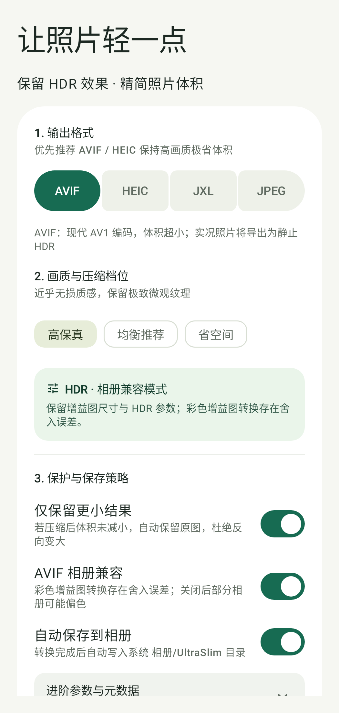

# UltraSlim

[](LICENSE)
[](https://github.com/linyusenzz/UltraSlim/releases)
[](#下载)

Android 离线照片转码工具，将 JPEG、HEIC、AVIF、JXL 转为更小的图片，支持 Ultra HDR / ISO 21496-1 Gain Map、纯 SDR 图片和部分动态照片。当前 Android 构建面向 **Android 8.0+ / arm64-v8a**。Android 8/9 支持转换和分享导出；直接保存相册需要 Android 10+。

*Offline Android photo transcoder: re-encode JPEG / HEIC / AVIF / JXL into smaller files while preserving Ultra HDR (ISO 21496-1) gain maps, with batch import, background conversion and a macOS companion for Apple Live Photo pairing. No server, everything on-device.*

<p align="left">
  
</p>

界面采用 Material 3 Expressive，支持手机、横屏、折叠屏内容分区，以及宽屏成品列表与详情并排。实现与验证边界见 [设计记录](docs/design/2026-10-12-expressive-adaptive.md)。

## 下载

从 [GitHub Releases](https://github.com/linyusenzz/UltraSlim/releases) 下载最新签名 APK（arm64-v8a），发行附件包含 `SHA256SUMS` 校验文件与开源许可快照。覆盖升级必须使用同一发行证书签名的安装包。

## 功能

- 转换 HEIC / AVIF / JXL / JPEG，支持质量、速度、分辨率和「仅保留更小结果」。
- HDR 默认保留原有增益图，不静默缩小、重建或降为 SDR；HEIC / AVIF 相册兼容模式有明确的色彩转换边界。
- 批量导入、文件夹导入（可包含子文件夹）、忽略 Live 照片、相册 HDR 筛选、先试转一张、历史记录和原图对比。
- 相册及文件夹导入不设照片数量上限；分批入队、限制检测并发，可中途停止。文件夹使用系统目录授权，输出沿用当前保存设置，不按来源子目录重建输出目录。
- 转换可在后台继续，显示进度通知；温控等待、任务中断和逐项进度恢复。
- 默认保留原图。可选择开启「校验后自动替换」，启用时提示；转换并保存回原相册后，在首页主动点击待替换卡片，再由系统确认回收原图；大批量每批均须主动开始。
- 配套 [UltraSlim Live（macOS）](apple-live/README.md)，将 Android 导出的动态 HEIC 导入包配对为 Apple Live Photo。

处理在本机完成，不需要服务器。**兼容模式不是彩色增益图 RGB 逐值无损；系统能解码，也不等于所有相册都能正确显示 HDR。** 支持边界见 [格式与兼容性](docs/COMPATIBILITY.md)。

## 开发与构建

完整步骤见 [构建与测试](docs/BUILDING.md)。已验证的开发环境为 Apple Silicon macOS，使用 JDK 17、Android SDK 37.0、NDK 27.2.12479018、CMake、Ninja、Meson、Python 3 和 Git。

工具准备好后，在项目根目录执行：

```bash
export JAVA_HOME=/opt/homebrew/opt/openjdk@17
export ANDROID_HOME="$HOME/Library/Android/sdk"
export ULTRASLIM_BUILD_ROOT="$HOME/.cache/ultraslim-build"
native/deps/build_deps.sh host
native/deps/build_deps.sh android arm64-v8a "$ANDROID_HOME/ndk/27.2.12479018" 26
scripts/verify.sh
```

APK 位于 `$ULTRASLIM_BUILD_ROOT/app/outputs/apk/`。Debug 包名为 `app.ultraslim.debug`；Release 构建输出未签名 APK。仓库不包含签名密钥、预编译编解码库或本机相册素材。

## 目录

```text
app/                  Android 应用、JVM/设备测试、Room schema
native/               转码核心、JNI、主机测试、原生依赖构建与补丁
apple-live/           可独立构建的 macOS Live Photo 配套工具
third_party/          内置上游源码、来源说明、依赖许可文本
tests/                主机与 Android 共用的测试素材及来源
scripts/              验证、仓库检查和 Android 色彩检查入口
docs/                 开发文档、历史验证报告、设计草案
gradle/               Gradle Wrapper 与依赖版本目录
.github/             issue / PR 模板
.gitea/               自托管 CI 配置
```

项目结构和数据流见 [架构说明](docs/ARCHITECTURE.md)，全部文档见 [文档索引](docs/README.md)。构建缓存、下载依赖、APK 和本地排查产物由 `.gitignore` 排除；旧本地构建目录集中保留在 `build/legacy/`。

## 参与贡献

问题报告、测试样本、文档和代码贡献都欢迎。提出问题时请附手机型号（可只写代号）、Android 版本、源文件/输出格式和复现步骤。分享测试图片前先确认可公开，并清除不希望公开的位置等元数据。开发约定见 [CONTRIBUTING.md](CONTRIBUTING.md)，安全问题的报告方式见 [SECURITY.md](SECURITY.md)。

主仓库托管在 GitHub。构建完整验证需要 macOS + Android NDK 环境，CI 以自托管运行器为主：GitHub Actions 工作流只在维护者自托管 runner 上执行，Gitea 配置保留在 `.gitea/`。外部贡献者可在本机运行 `scripts/verify.sh`，需要自行准备工具链。

## 许可证

UltraSlim 原创代码采用 **GNU GPL v3.0（GPL-3.0-only）**，版权与免责声明见 [NOTICE](NOTICE)，完整许可文本见 [LICENSE](LICENSE)。第三方源码、补丁涉及的上游代码和测试图片保留其各自许可证，不因顶层协议改变授权。

依赖来源与许可见 [THIRD_PARTY_NOTICES.md](THIRD_PARTY_NOTICES.md)。发布源码、签名包和依赖源码的准备步骤见 [发布说明](docs/RELEASING.md)，版本变化见 [CHANGELOG.md](CHANGELOG.md)。
